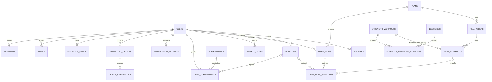

# Banco de dados

Modelo relacional do Paceless (Postgres 17 no Supabase). O app fala direto com o
banco, então **a RLS é a única barreira**: toda tabela tem RLS ativa, `anon` não
tem acesso a nada e cada política usa `(select auth.uid())`.
Contexto: [decisoes.md](./decisoes.md).

Tabelas já existentes e fora desta trilha: `profiles`, `subscriptions`, `activities`.
O perfil nasce por trigger: `on_auth_user_created` (`after insert on auth.users`) chama
`public.handle_new_user()` (`security definer`, `search_path = ''`, execute revogado de
`public`/`anon`/`authenticated`), que insere `profiles (id, name)` com o `name` de
`raw_user_meta_data` e `on conflict (id) do nothing`. A migration
`20261020010000_handle_new_user.sql` recria função e trigger de forma idempotente e faz
backfill dos usuários sem perfil (o trigger original não existia no banco remoto). O client
nunca assume que a linha existe: updates em `profiles` usam `.select('id')` e tratam
zero linhas como erro; upserts parciais usam `defaultToNull: false`.

Sem geração de plano por IA: o schema só guarda planos (catálogo ou do usuário) e
a agenda.

## Visão geral

## Catálogo x dados do usuário

| Tipo | Tabelas | Quem escreve |
|---|---|---|
| Catálogo (leitura para todo autenticado) | `exercises`, `achievements`, `plans`/`plan_weeks`/`plan_workouts` com `owner_id is null`, `strength_workouts`/`strength_workout_exercises` com `owner_id is null` | Só servidor (migration, seed, service role) |
| Misto (`owner_id` nulo = catálogo) | `plans`, `strength_workouts` | Plano: só servidor. Treino de força do usuário: o próprio usuário |
| Dados do usuário | `user_plans`, `user_plan_workouts`, `weekly_goals`, `user_achievements`, `notification_settings`, `connected_devices`, `meals`, `nutrition_goals`, `anamnesis` | Ver tabela abaixo |
| Só servidor (sem acesso do client) | `device_credentials` | Service role |

## Tabelas

### Musculação (`20261019210000_strength.sql`)

| Tabela | Propósito | RLS e escrita do client |
|---|---|---|
| `exercises` | Biblioteca de exercícios (slug, grupo muscular, categoria, nível, texto, `media_path` no Storage) | Só select |
| `strength_workouts` | Treino de força: catálogo (Força A, Core) ou do usuário ("Novo treino"). `owner_id` nulo = catálogo | Select de catálogo + próprios. Insert/update/delete só dos próprios, e nunca `is_premium = true` |
| `strength_workout_exercises` | Exercícios do treino: `position`, `sets`, `reps` ou `duration_seconds`, `rest_seconds` | Select se o treino é visível. Escrita só se o treino é do usuário |

Sessão de força executada vira linha em `activities` com `type = 'strength'`
(sem tabela de sessão nem carga por série no MVP).

### Plano de corrida (`20261019210100_training_plans.sql`, `20261019210200_user_plans.sql`)

| Tabela | Propósito | RLS e escrita do client |
|---|---|---|
| `plans` | Plano (nome, `goal`, `level`, `weeks`, `sessions_per_week`, `is_premium`). `owner_id` nulo = catálogo | Select de catálogo + próprios. Sem escrita (planos de usuário serão gerados pelo servidor/IA) |
| `plan_weeks` | Semana N do plano | Select se o plano é visível |
| `plan_workouts` | Treino do dia: `day_of_week` (1 = segunda ... 7 = domingo), `kind` run/strength/rest, `intensity` easy/moderate/hard, `zone` 1 a 5, meta de duração/distância, `strength_workout_id` opcional | Select se a semana é visível |
| `user_plans` | Inscrição: `plan_id`, `started_at`, `current_week`, `status`. Índice único parcial garante um plano `active` por usuário | Select/delete próprios. Update só de `current_week` e `status` (grant por coluna). Insert só via `enroll_in_plan` |
| `user_plan_workouts` | Agenda: `scheduled_date`, `status` planned/done/skipped, `activity_id` concluído | Select próprio. Update só de `status`, `activity_id`, `completed_at`; `activity_id` precisa ser atividade do próprio usuário. Insert só via `enroll_in_plan` |

`public.enroll_in_plan(p_plan_id, p_start_date)` (`security definer`,
`search_path = ''`, só `authenticated`): valida que o plano é visível, cancela o plano
ativo anterior, cria `user_plans` e materializa a agenda a partir da segunda-feira
da semana de `p_start_date` (descansos não geram linha; a tela deriva "Descanso" dos dias vazios).
Planos com `is_premium` exigem linha ativa em `subscriptions` (entitlement `premium`,
não expirada); caso contrário levanta `premium required` (`42501`). Um `pg_advisory_xact_lock`
por usuário serializa inscrições concorrentes, e as linhas `planned` do plano cancelado são
removidas para não duplicar a agenda (histórico `done`/`skipped` é mantido).

### Gamificação (`20261019210300_gamification.sql`)

| Tabela | Propósito | RLS e escrita do client |
|---|---|---|
| `weekly_goals` | Meta semanal: `week_start` (segunda), `target_sessions`, `target_distance_meters`. O "cumprido" não é gravado: sai de `activities` | CRUD próprio |
| `achievements` | Catálogo: `code`, `title`, `kind` milestone/personal, `metric` + `threshold` | Só select |
| `user_achievements` | Conquistas ganhas, única por (`user_id`, `achievement_id`), `activity_id` de origem | Só select próprio. Quem concede é o servidor (trigger/Edge Function) |

Sem ranking, sem sequência diária, sem tabela social ([gamificacao.md](./pesquisa/gamificacao.md)).

### Notificações (`20261019210400_notification_settings.sql`)

`notification_settings` (1 linha por usuário): `training_reminders`, `reminder_time`,
`training_days` (`smallint[]`, 1 a 7, validado por check), `timezone`. Select/insert/update próprios.
Tokens de push ficam para a fase de push remoto (`push_tokens`, não criada agora).

### Dispositivos (`20261019210500_connected_devices.sql`)

| Tabela | Propósito | RLS e escrita do client |
|---|---|---|
| `connected_devices` | Uma linha por (`user_id`, `provider`): `health_connect`, `healthkit`, `garmin`, `strava`; `status`, `granted_scopes`, `last_sync_at` | Select e delete próprios. Insert/update só de `health_connect` e `healthkit` (acesso local no aparelho, sem token). Garmin/Strava (OAuth) só pelo servidor. Update restrito a `status`, `granted_scopes`, `last_sync_at` |
| `device_credentials` | `access_token`/`refresh_token` do OAuth | RLS ativa, **sem política e sem grant**: inacessível ao client |

### Nutrição (`20261019210600_nutrition.sql`)

| Tabela | Propósito | RLS e escrita do client |
|---|---|---|
| `nutrition_goals` | Meta diária (kcal, proteína, carbo, gordura) | CRUD próprio |
| `meals` | Refeição do dia: `meal_type` breakfast/lunch/dinner/snack (café/almoço/jantar/lanche), macros opcionais, notas | CRUD próprio |
| `anamnesis` | Restrições e condições de saúde (`text[]`), com `consented_at` obrigatório | CRUD próprio |

## LGPD

- `anamnesis` (diabetes, intolerância etc.) é **dado pessoal sensível de saúde**
  (LGPD, art. 11): exige consentimento específico e destacado. O `consented_at not null`
  força o app a coletar o consentimento antes de gravar. Delete próprio é permitido
  (revogação). A política de privacidade precisa citar essa finalidade.
- `meals.notes`, `nutrition_goals`, `connected_devices` e dados de atividade também
  são dados de saúde/bem-estar: mesma RLS own-only, nunca expostos entre usuários.
- Exclusão de conta: toda tabela de usuário referencia `auth.users` com `on delete cascade`
  (`delete-account` apaga tudo). `user_plans.plan_id` usa `restrict` no catálogo: não
  apague plano de catálogo que tenha inscritos (arquive em vez disso).
- Não colocar dados de anamnese em logs, analytics ou prompts de IA sem base legal;
  a IA de nutrição passa por Edge Function.

## Decisões de modelagem

- Chaves estrangeiras indexadas; colunas usadas em políticas indexadas; `user_id` denormalizado
  em `user_plan_workouts` para a RLS não precisar de join.
- Escrita pelo client limitada por grants de coluna (`user_plans`, `user_plan_workouts`,
  `connected_devices`), além da RLS.
- Valores de domínio em inglês nos checks (`breakfast`, `easy`...); a tradução é da UI.
- Tokens de dispositivo em tabela separada, para o `select` do client nunca tocar segredo.
- Segredos em `device_credentials` estão em texto: avaliar Supabase Vault ou criptografia
  antes de ligar Garmin/Strava.

## Ordem de aplicação

1. `20261019180000_create_activities.sql` (existente)
2. `20261019204923_create_profiles.sql` (existente; define `set_updated_at`)
3. `20261019205124_create_subscriptions.sql` (existente)
4. `20261019210000_strength.sql` (antes dos planos: `plan_workouts` referencia `strength_workouts`)
5. `20261019210100_training_plans.sql`
6. `20261019210200_user_plans.sql` (depende de `plans`, `plan_workouts`, `activities`)
7. `20261019210300_gamification.sql` (depende de `activities`)
8. `20261019210400_notification_settings.sql`
9. `20261019210500_connected_devices.sql`
10. `20261019210600_nutrition.sql`
11. `20261019230000_profile_preferences.sql`
12. `20261019230100_avatars_storage.sql`
13. `20261019230200_activities_walk_type.sql` (tipo `walk` e `splits`)
14. `20261020000000_restrict_core_table_grants.sql` (revoga `anon` e privilégios excessivos em `activities` e `profiles`)

As trilhas paralelas (colunas novas em `profiles`, tipo `walk` e splits em `activities`)
não conflitam com estas migrations; só precisam vir antes se alguma passar a depender delas.

## Tipos TypeScript

Escritos à mão em `types/training.ts` e `types/wellbeing.ts`, reexportados por
`types/database.ts`. Depois de aplicar as migrations, dá para trocar por
`supabase gen types typescript` (MCP: `generate_typescript_types`).
