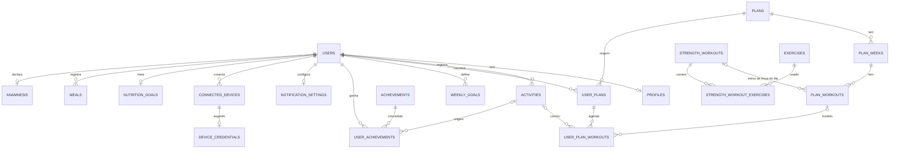

# Banco de dados

Modelo relacional do Paceless (Postgres 17 no Supabase). O app fala direto com o
banco, então **a RLS é a única barreira**: toda tabela tem RLS ativa, `anon` não
tem acesso a nada e cada política usa `(select auth.uid())`.
Contexto: [decisoes.md](./decisoes.md).

As 16 primeiras migrations de `supabase/migrations/` estão aplicadas no projeto remoto
`twfqvvfpnspbdaytrerm` (confirmado em 21/10/2026). A 17ª, `20261029000000_generated_plans.sql`, ainda precisa ser aplicada com `supabase db push` antes do deploy de `generate-plan`. O app só usa hoje `profiles`,
`subscriptions`, `activities` e o Storage `avatars`; as demais tabelas existem no
banco, mas ainda não têm tela.

Tabelas das primeiras migrations: `profiles`, `subscriptions`, `activities`.
O perfil nasce por trigger: `on_auth_user_created` (`after insert on auth.users`) chama
`public.handle_new_user()` (`security definer`, `search_path = ''`, execute revogado de
`public`/`anon`/`authenticated`), que insere `profiles (id, name)` com o `name` de
`raw_user_meta_data` e `on conflict (id) do nothing`. A migration
`20261020010000_handle_new_user.sql` recria função e trigger de forma idempotente e faz
backfill dos usuários sem perfil (o trigger original não existia no banco remoto). O client
nunca assume que a linha existe: updates em `profiles` usam `.select('id')` e tratam
zero linhas como erro; upserts parciais usam `defaultToNull: false`.

Sem geração de plano por IA: o schema só guarda planos (catálogo ou do usuário) e
a agenda.

## Visão geral

## Catálogo x dados do usuário

| Tipo | Tabelas | Quem escreve |
|---|---|---|
| Catálogo (leitura para todo autenticado) | `exercises`, `achievements`, `plans`/`plan_weeks`/`plan_workouts` com `owner_id is null`, `strength_workouts`/`strength_workout_exercises` com `owner_id is null` | Só servidor (migration, seed, service role) |
| Misto (`owner_id` nulo = catálogo) | `plans`, `strength_workouts` | Plano: só servidor. Treino de força do usuário: o próprio usuário |
| Dados do usuário | `user_plans`, `user_plan_workouts`, `weekly_goals`, `user_achievements`, `notification_settings`, `connected_devices`, `meals`, `nutrition_goals`, `anamnesis` | Ver tabela abaixo |
| Só servidor (sem acesso do client) | `device_credentials` | Service role |

## Tabelas

### Perfil (`profiles`)

- `goal`: `complete_5k`, `race`, `fitness` ou `weight_loss` (check `profiles_goal_check`).
- `level`: `total_beginner`, `beginner`, `intermediate` ou `advanced` (check `profiles_level_check`). Só `total_beginner` e `beginner` recebem plano (ver [planos.md](./planos.md)).
- `strength`: `yes`, `maybe_later` ou `no`, default `'no'` e `not null`. Não é perguntado no onboarding; editável em Configurações do plano.
- `onboarding_completed_at`: gravado quando o primeiro acesso termina (plano gerado ou nível não elegível). Nulo significa que o app manda a pessoa para `/onboarding`. Falha de rede não grava.
- Migration `20261102000000_prd_onboarding_values.sql` troca os valores antigos (zera goal, level e a conclusão do onboarding), recria os checks e marca `plans.goal` e `plans.level` como `not valid` para aceitar linhas antigas. **Não aplicada no remoto**.

### Musculação (`20261019210000_strength.sql`)

| Tabela | Propósito | RLS e escrita do client |
|---|---|---|
| `exercises` | Biblioteca de exercícios (slug, grupo muscular, categoria, nível, texto, `media_path` no Storage) | Só select |
| `strength_workouts` | Treino de força: catálogo (Força A, Core) ou do usuário ("Novo treino"). `owner_id` nulo = catálogo | Select de catálogo + próprios. Insert/update/delete só dos próprios, e nunca `is_premium = true` |
| `strength_workout_exercises` | Exercícios do treino: `position`, `sets`, `reps` ou `duration_seconds`, `rest_seconds` | Select se o treino é visível. Escrita só se o treino é do usuário |

Sessão de força executada vira linha em `activities` com `type = 'strength'`
(sem tabela de sessão nem carga por série no MVP).

### Plano de corrida (`20261019210100_training_plans.sql`, `20261019210200_user_plans.sql`)

| Tabela | Propósito | RLS e escrita do client |
|---|---|---|
| `plans` | Plano (nome, `goal`, `level`, `weeks`, `sessions_per_week`, `is_premium`, `settings_hash`, `generator_version`, `tier` free/full). `owner_id` nulo = catálogo; planos do usuário têm `owner_id` dele | Select de catálogo + próprios. Sem escrita: planos de usuário são gerados por regras na Edge Function `generate-plan` |
| `plan_weeks` | Semana N do plano | Select se o plano é visível |
| `plan_workouts` | Treino do dia: `day_of_week` (1 = segunda ... 7 = domingo), `kind` run/strength/rest, `intensity` easy/moderate/hard, `zone` 1 a 5, meta de duração/distância, `description` (PT-BR), `steps` (jsonb: aquecimento, blocos, desaquecimento), `strength_workout_id` opcional | Select se a semana é visível |
| `user_plans` | Inscrição: `plan_id`, `started_at`, `current_week`, `current_attempt` (tentativa da semana atual), `current_week_started_on` (segunda-feira da semana atual), `status`. Índice único parcial garante um plano `active` por usuário | Select/delete próprios. Sem update pelo client: avanço e repetição de semana só pelas RPCs |
| `user_plan_workouts` | Agenda: `scheduled_date`, `status` (6 estados, abaixo), `week_number`, `attempt` (tentativa da semana, começa em 1), `started_at`, `interrupted_at`, `interruption_reason` (`discarded`, `too_short`, `superseded`), `activity_id` e `completed_at` | Select próprio. Sem update pelo client (desde a migration `20261102020000_plan_session_states.sql`). `completed` só pelo trigger `activities_link_plan_workout`; início, pausa e interrupção por `transition_plan_session`. Insert só via `enroll_in_plan`, `replace_generated_plan` ou `repeat_plan_week` |

`public.enroll_in_plan(p_plan_id, p_start_date)` (`security definer`,
`search_path = ''`, só `authenticated`): valida que o plano é visível, cancela o plano
ativo anterior, cria `user_plans` e materializa a agenda a partir da segunda-feira
da semana de `p_start_date` (descansos não geram linha; a tela deriva "Descanso" dos dias vazios).
Planos com `is_premium` exigem linha ativa em `subscriptions` (entitlement `premium`,
não expirada); caso contrário levanta `premium required` (`42501`). Um `pg_advisory_xact_lock`
por usuário serializa inscrições concorrentes, e as linhas `planned` do plano cancelado são
removidas para não duplicar a agenda (histórico `completed` é mantido).

#### Estados de sessão (BR-02)

`user_plan_workouts.status` aceita `scheduled` (programada), `in_progress`, `paused`,
`completed` (atividade vinculada), `interrupted` (começou e foi encerrada sem salvar) e
`cancelled`. Os antigos `planned`, `done` e `skipped` foram migrados para `scheduled`,
`completed` e `cancelled`. "Não realizado" é só estado exibido (programada com data passada),
nunca gravado. Transições válidas estão na spec da fase 3 (`docs/spec-fase3.md`, seção 2.1);
`completed` e `cancelled` são finais, e a mesma transição repetida devolve o estado atual.

`public.transition_plan_session(p_session, p_to, p_reason)` (`security definer`, só
`authenticated`) é a única escrita de estado pelo app, para `in_progress`, `paused` e
`interrupted`. Recusa transições inválidas com `invalid_transition`, sessão de outra semana ou
tentativa com `session_not_current`, e plano não ativo com `plan_not_active`.

#### Semanas: estado, avanço e repetição

- `public.get_plan_week_status(p_today)`: estado da semana atual (encerrada, aderência,
  bloqueio) calculado no servidor.
- `public.advance_plan_week(p_today)`: avança a semana (BR-03). Falha com
  `cannot_advance:<motivo>` quando não pode. Não há avanço automático pelo calendário.
- `public.repeat_plan_week(p_today)`: cria nova tentativa da semana (PLAN-04). As linhas da
  tentativa anterior ficam intactas.
- Funções internas (sem grant para o client): `plan_week_state` e `plan_next_week_start`.

#### Progresso e conquistas

- `public.get_progress_summary(p_today)`: totais de sessões, distância e tempo da semana e
  desde o início (fuso America/Sao_Paulo). Só para `authenticated`.
- Trigger `activities_post_award_achievements` (`after insert` em `activities`): concede
  `first_workout` e `first_week_completed` (DP-29 a DP-34). Ordem alfabética garante que roda depois
  de `activities_link_plan_workout`. Não renomear.
- `p_today` precisa estar a no máximo um dia de `America/Sao_Paulo` (`invalid_today`).

Migrations de estados e progressão: `20261102020000_plan_session_states.sql` (estados,
colunas novas, grants de update removidos) e `20261102030000_plan_week_progression.sql`
(RPCs de semana, `replace_generated_plan` e `enroll_in_plan` ajustadas). Ambas **não aplicadas
no remoto** e sempre juntas.

### Plano gerado por regras (`20261029000000_generated_plans.sql`)

- `plans`: novas colunas `settings_hash` (chave das entradas do plano, para não regenerar à toa),
  `generator_version` e `tier` (`free` ou `full`). Índice `(owner_id, settings_hash)`.
- `plan_workouts`: novas colunas `description` e `steps` (`jsonb`, sempre array).
- `public.replace_generated_plan(p_user uuid, p_start date, p_today date, p_force boolean, p_plan jsonb) returns uuid`:
  `security definer`, `search_path = ''`, execute revogado de `public`/`anon`/`authenticated` e
  concedido só a `service_role`. Numa transação, com o mesmo `pg_advisory_xact_lock` de `enroll_in_plan`:
  - Lê o `user_plans` ativo e o `settings_hash` do plano. Se `p_force` é falso e o hash é igual ao
    de `p_plan ->> 'settings_hash'`, devolve o `user_plans.id` atual e não faz mais nada.
  - No plano anterior, marca como `skipped` os `planned` com data `< p_today` e apaga os `planned`
    com data `>= p_today`. O corte é `p_today` (a data de hoje em São Paulo), não `p_start`.
  - Cancela o `user_plans` anterior (o `done` e o `skipped` ficam nele).
  - Insere `plans`, `plan_weeks`, `plan_workouts`, `user_plans` (com `p_start`) e `user_plan_workouts`.
    Para cada treino novo, procura no plano anterior uma linha `done` ou `skipped` com a mesma
    `scheduled_date`, a mesma `plan_workouts.position` e o mesmo `kind`. Se achar, copia `status`,
    `activity_id` e `completed_at`. Se não achar, entra `skipped` quando a data é anterior a `p_today`,
    e `planned` nos outros casos.
- O `weeks` do plano é o número de semanas do array `weeks` do JSON.
- Quem chama é a Edge Function `generate-plan` com a service role. O client nunca chama a RPC.
  Regras e números em [planos.md](./planos.md).
- Migration `20261029010000_plan_session_link.sql` (Parte 2):
  - `plans.full_weeks smallint` (`>= 1`): total de semanas do plano completo. No free, `weeks`
    é 2 e `full_weeks` é o total (ex.: 12). Planos antigos ficam nulos e a UI usa `weeks`.
  - `activities.user_plan_workout_id uuid` (FK para `user_plan_workouts`, `on delete set null`,
    com índice). É o vínculo entre o treino feito e a sessão do plano.
  - Policy `activities_insert_own` recriada: o insert só passa se `user_id` for do usuário e, se
    houver `user_plan_workout_id`, a sessão pertencer a esse usuário e o `user_plans` estiver
    `active`. Insert de outro usuário, ou de sessão de plano cancelado, falha por RLS.
  - Trigger `activities_link_plan_workout` (`after insert`, só quando `user_plan_workout_id` não é
    nulo) chama `public.link_activity_to_plan_workout()`. Ela marca a sessão como `done`, com
    `activity_id = new.id` e `completed_at = new.ended_at`, e só se a sessão for do mesmo usuário
    e ainda não estiver `done`. A função é `security definer`, `search_path = ''`, e o execute
    está revogado de `public`/`anon`/`authenticated`. O client nunca faz `update` em
    `user_plan_workouts`: o vínculo é só o insert da atividade.
  - `replace_generated_plan` foi recriada (`create or replace`, mesma assinatura) para gravar
    `plans.full_weeks` a partir de `p_plan ->> 'full_weeks'`.
  - Histórico: quando o plano é regenerado, a RPC copia `status` e `activity_id` das sessões
    antigas. `activities.user_plan_workout_id` antigo continua apontando para a linha do plano
    cancelado. A UI lê só o plano ativo, então isso não aparece.

### Gamificação (`20261019210300_gamification.sql`)

| Tabela | Propósito | RLS e escrita do client |
|---|---|---|
| `weekly_goals` | Meta semanal: `week_start` (segunda), `target_sessions`, `target_distance_meters`. O "cumprido" não é gravado: sai de `activities` | CRUD próprio |
| `achievements` | Catálogo: `code`, `title`, `kind` milestone/personal, `metric` + `threshold`. Semeadas: `first_workout` (Primeiro treino) e `first_week_completed` (Semana concluída) | Só select |
| `user_achievements` | Conquistas ganhas, única por (`user_id`, `achievement_id`), `activity_id` de origem. Concedidas pelo trigger `activities_post_award_achievements` (após inserir em `activities`) | Só select próprio. Quem concede é só o servidor |

Sem ranking, sem sequência diária, sem tabela social ([gamificacao.md](./pesquisa/gamificacao.md)).

### Notificações (`20261019210400_notification_settings.sql`)

`notification_settings` (1 linha por usuário): `training_reminders`, `reminder_time`,
`training_days` (`smallint[]`, 1 a 7, validado por check), `timezone`. Select/insert/update próprios.
Tokens de push ficam para a fase de push remoto (`push_tokens`, não criada agora).

### Dispositivos (`20261019210500_connected_devices.sql`)

| Tabela | Propósito | RLS e escrita do client |
|---|---|---|
| `connected_devices` | Uma linha por (`user_id`, `provider`): `health_connect`, `healthkit`, `garmin`, `strava`; `status`, `granted_scopes`, `last_sync_at` | Select e delete próprios. Insert/update só de `health_connect` e `healthkit` (acesso local no aparelho, sem token). Garmin/Strava (OAuth) só pelo servidor. Update restrito a `status`, `granted_scopes`, `last_sync_at` |
| `device_credentials` | `access_token`/`refresh_token` do OAuth | RLS ativa, **sem política e sem grant**: inacessível ao client |

### Nutrição (`20261019210600_nutrition.sql`)

| Tabela | Propósito | RLS e escrita do client |
|---|---|---|
| `nutrition_goals` | Meta diária (kcal, proteína, carbo, gordura) | CRUD próprio |
| `meals` | Refeição do dia: `meal_type` breakfast/lunch/dinner/snack (café/almoço/jantar/lanche), macros opcionais, notas | CRUD próprio |
| `anamnesis` | Restrições e condições de saúde (`text[]`), com `consented_at` obrigatório | CRUD próprio |

### Frequência cardíaca BLE (`20261029140000_ble_heart_rate.sql`)

- `connected_devices`: o check de `provider` passa a aceitar `ble_hr`. Novas colunas `device_id text` e `device_name text`. Check `connected_devices_ble_device_check`: `provider <> 'ble_hr' or device_id is not null`. As policies de insert e update aceitam `health_connect`, `healthkit` e `ble_hr`. Grant de update ampliado para `(device_id, device_name)`. Continuam valendo `status`, `granted_scopes` e `last_sync_at`.
- `profiles.max_heart_rate smallint`, entre 100 e 230. Sincroniza com Preferências. Sem data de nascimento: a zona de FC só existe com este valor.
- `activity_samples`: uma linha por segundo com leitura de FC do treino.
  - Colunas: `activity_id uuid` (FK para `activities`, `on delete cascade`), `user_id uuid` (FK para `auth.users`, default `auth.uid()`), `t_offset_s integer` (≥ 0), `hr_bpm smallint` (30 a 230, nulo permitido).
  - Chave primária `(activity_id, t_offset_s)`.
  - RLS ativa. `select` e `delete` só do dono. `insert` só do dono e só se a atividade for do usuário.
  - Grants: `revoke all` de `anon` e `authenticated`, depois `select, insert, delete` para `authenticated`.
  - Não há `update`. Atividade e amostras não são editadas depois de salvas.
  - Amostras não guardam `lat`/`lng` (a rota já fica em `activities.route`) nem intervalos RR.

## LGPD

- `anamnesis` (diabetes, intolerância etc.) é **dado pessoal sensível de saúde**
  (LGPD, art. 11): exige consentimento específico e destacado. O `consented_at not null`
  força o app a coletar o consentimento antes de gravar. Delete próprio é permitido
  (revogação). A política de privacidade precisa citar essa finalidade.
- `meals.notes`, `nutrition_goals`, `connected_devices` e dados de atividade também
  são dados de saúde/bem-estar: mesma RLS own-only, nunca expostos entre usuários.
- Exclusão de conta: toda tabela de usuário referencia `auth.users` com `on delete cascade`
  (`delete-account` apaga tudo). `user_plans.plan_id` usa `no action` (migration `20261029000000_generated_plans.sql`):
  planos gerados pertencem ao usuário e caem em cascata junto com `user_plans` na exclusão de conta, e `no action` checa
  só no fim do statement. Plano de catálogo com inscritos continua sem poder ser apagado (arquive em vez disso).
- Não colocar dados de anamnese em logs, analytics ou prompts de IA sem base legal;
  a IA de nutrição passa por Edge Function.

## Decisões de modelagem

- Chaves estrangeiras indexadas; colunas usadas em políticas indexadas; `user_id` denormalizado
  em `user_plan_workouts` para a RLS não precisar de join.
- Escrita pelo client limitada por grants de coluna (`user_plans`, `user_plan_workouts`,
  `connected_devices`), além da RLS.
- Valores de domínio em inglês nos checks (`breakfast`, `easy`...); a tradução é da UI.
- Tokens de dispositivo em tabela separada, para o `select` do client nunca tocar segredo.
- Migration `20261029130000_activities_external_source.sql` (origem dos treinos, fase 1 de
  relógios):
  - `activities.source text not null default 'paceless'`, com check em `paceless`, `healthkit`
    e `health_connect`. Treinos do Paceless ficam com o default, sem mudança no client.
  - `activities.external_id text`: id do treino no Apple Saúde ou no Health Connect. Check
    `activities_external_id_check`: `external_id` é nulo se e só se `source = 'paceless'`.
  - `activities.source_name text`: nome da fonte no Saúde (ex.: "Garmin Connect"), usado no
    rótulo de origem da lista de atividades.
  - `activities.avg_heart_rate` e `max_heart_rate smallint`, entre 20 e 250.
  - Unique `activities_user_source_external_key (user_id, source, external_id)`. É uma unique
    constraint completa, não índice parcial, porque o `onConflict` do PostgREST exige uma
    constraint. Linhas do Paceless têm `external_id` nulo, e nulos são distintos no unique.
  - Importação: o client faz `upsert` com `onConflict: 'user_id,source,external_id'` e
    `ignoreDuplicates`, que vira `ON CONFLICT DO NOTHING`. Não precisa de grant de update. A
    policy `activities_insert_own` vale para as linhas importadas, e `user_plan_workout_id`
    fica nulo.
- Migration `20261102010000_activity_perceived_effort.sql` (sensação do treino, RUN-04):
  - `activities.perceived_effort text`, nulo quando não informado ou pulado. Check em
    `very_easy`, `easy`, `moderate`, `hard` e `very_hard`.
  - Grant de update só na coluna `perceived_effort`. As demais colunas seguem imutáveis para o
    client.
  - Policy `activities_update_own_effort` (update, `to authenticated`): `user_id` igual a
    `auth.uid()` nos dois lados (`using` e `with check`).
  - Trigger `activities_link_plan_workout` é `after insert`: o update de sensação não remarca o
    plano nem dispara nada.
- Segredos em `device_credentials` estão em texto: avaliar Supabase Vault ou criptografia
  antes de ligar Garmin/Strava.

## Ordem de aplicação

1. `20261019180000_create_activities.sql` (existente)
2. `20261019204923_create_profiles.sql` (existente; define `set_updated_at`)
3. `20261019205124_create_subscriptions.sql` (existente)
4. `20261019210000_strength.sql` (antes dos planos: `plan_workouts` referencia `strength_workouts`)
5. `20261019210100_training_plans.sql`
6. `20261019210200_user_plans.sql` (depende de `plans`, `plan_workouts`, `activities`)
7. `20261019210300_gamification.sql` (depende de `activities`)
8. `20261019210400_notification_settings.sql`
9. `20261019210500_connected_devices.sql`
10. `20261019210600_nutrition.sql`
11. `20261019230000_profile_preferences.sql`
12. `20261019230100_avatars_storage.sql`
13. `20261019230200_activities_walk_type.sql` (tipo `walk` e `splits`)
14. `20261020000000_restrict_core_table_grants.sql` (revoga `anon` e privilégios excessivos em `activities` e `profiles`)
15. `20261020010000_handle_new_user.sql` (trigger de perfil no signup e backfill)
16. `20261021000000_profiles_training_days.sql` (coluna `profiles.training_days`, `smallint[]` de 1 a 7, escolhida no onboarding entre combinações predefinidas em `lib/trainingDayCombos.ts`)
17. `20261029000000_generated_plans.sql` (colunas de geração em `plans` e `plan_workouts`, índice `plans_owner_id_hash_idx` e a RPC `replace_generated_plan(p_user, p_start, p_today, p_force, p_plan)`, só `service_role`). **Ainda não aplicada no remoto**: aplicar antes do deploy de `generate-plan`

18. `20261029010000_plan_session_link.sql` (Parte 2: `plans.full_weeks`, `activities.user_plan_workout_id`, policy `activities_insert_own` nova, trigger `activities_link_plan_workout` e `replace_generated_plan` recriada). **Ainda não aplicada no remoto**: depende de `20261029000000_generated_plans.sql`.
19. `20261029130000_activities_external_source.sql` (origem das atividades: `source`, `external_id`, `source_name`, FC média e máxima, check e unique `(user_id, source, external_id)`). **Não aplicada no remoto**. Não há mudança de grants nem de RLS.
20. `20261029140000_ble_heart_rate.sql` (cinta BLE em `connected_devices`, `profiles.max_heart_rate`, tabela `activity_samples`). **Não aplicada no remoto**.

21. `20261102000000_prd_onboarding_values.sql` (valores de goal e level do PRD, default de `strength`, significado de `onboarding_completed_at`). **Não aplicada no remoto**.
22. `20261102010000_activity_perceived_effort.sql` (`activities.perceived_effort`, grant de update só nessa coluna, policy `activities_update_own_effort`). **Não aplicada no remoto**. Depende de `activities`.
23. `20261102020000_plan_session_states.sql` e `20261102030000_plan_week_progression.sql` (estados de sessão, tentativas e RPCs de semana, ver acima). **Não aplicadas no remoto**; aplicar as duas juntas.

A ordem acima segue a ordem dos timestamps dos arquivos. a ordem dos timestamps dos arquivos.

### Ordem de deploy

A migration `20261029010000_plan_session_link.sql` e o deploy da Edge Function `generate-plan`
com `GENERATOR_VERSION = 3` (`supabase/functions/_shared/plan/hash.ts`) precisam ir ao ar **antes**
do build do app. O app passa a enviar `user_plan_workout_id` no upsert de `activities`. Sem a
coluna e a policy novas, esse upsert falha e a atividade fica presa na fila offline
(`lib/activityQueue.ts`) até a migration existir no remoto.

Sequência: (1) `20261029000000_generated_plans.sql`, se ainda não estiver no remoto; (2)
`20261029010000_plan_session_link.sql`; (3) deploy de `generate-plan`; (4) só então o build do app.

## Tipos TypeScript

Escritos à mão em `types/training.ts` e `types/wellbeing.ts`, reexportados por
`types/database.ts`. As migrations já estão aplicadas, então dá para trocar por
`supabase gen types typescript` (MCP: `generate_typescript_types`).
